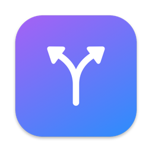
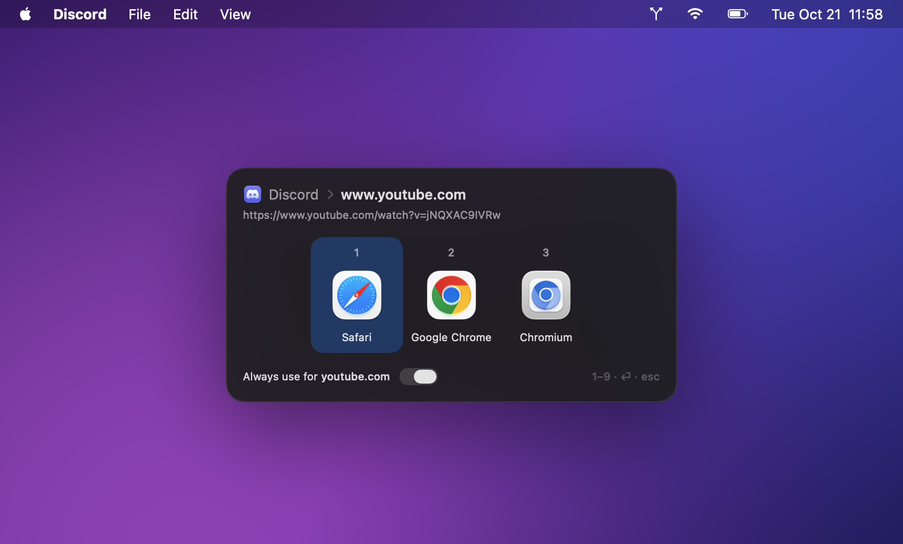
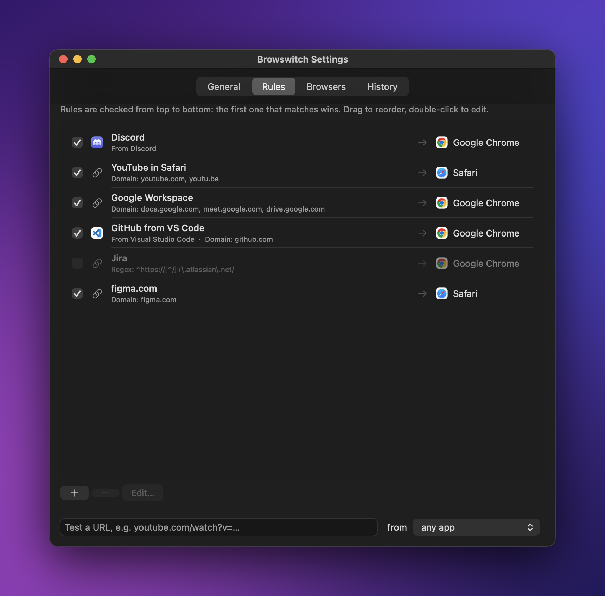
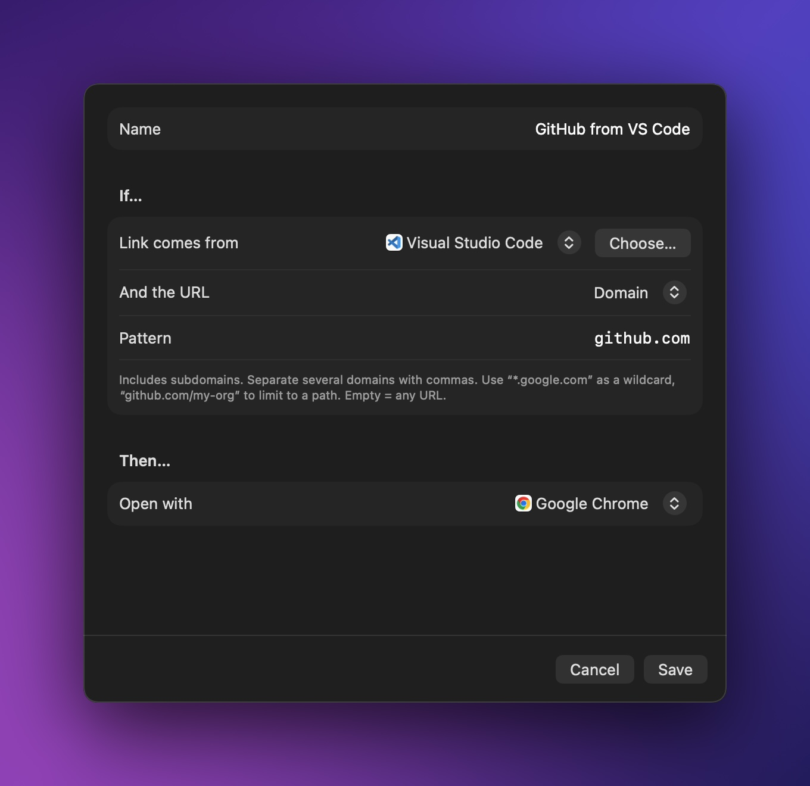
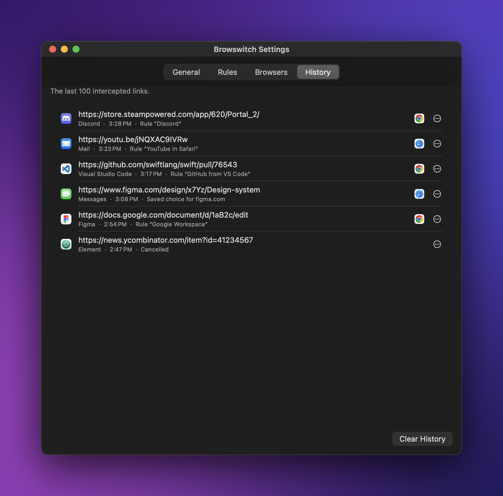
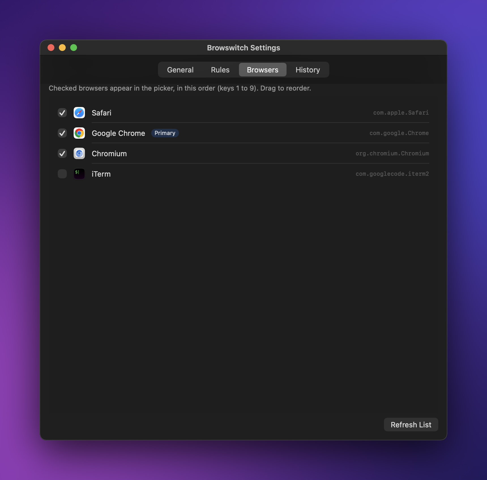
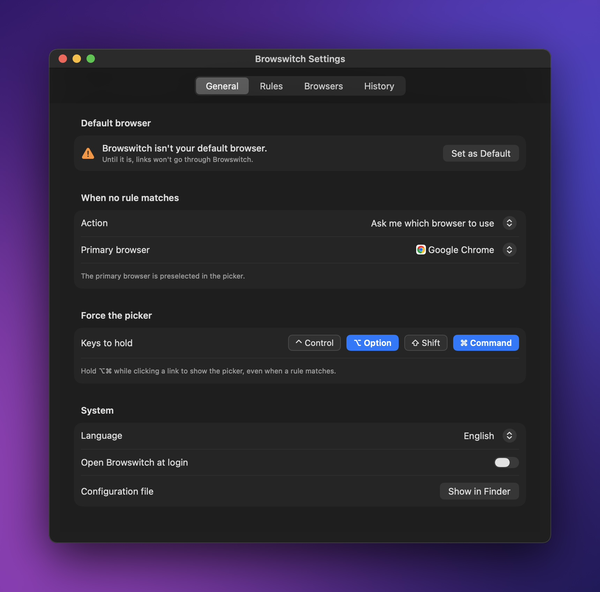

<p align="center">
  
</p>

<h1 align="center">Browswitch</h1>

<p align="center">
  <strong>Every link opens in the right browser.</strong><br>
  A small native macOS app that intercepts your links and sends them to the browser you want,<br>
  based on the app they come from or the URL itself.
</p>

<p align="center">
  
  
  
  
  <a href="LICENSE"></a>
  
</p>

<p align="center">
  
</p>

---

## Why

Google Meet calls need Chrome, YouTube belongs in Safari, work links go to another browser… yet macOS only knows a single default browser.

Browswitch registers itself as your default browser and forwards each link in a split second. When no rule matches a link, it shows a picker, and one toggle remembers your choice for that domain.

## Features

- **Rules by source app**: “everything from Discord → Chrome”.
- **Rules by URL**:
  - domains, subdomains included, several at once (`youtube.com, youtu.be`);
  - wildcards (`*.google.com`) and paths (`github.com/my-org`);
  - “URL contains” or regular expressions.
- **Combined conditions**: “GitHub *from* VS Code → Chrome”.
- **You control the order**: the first matching rule wins, and you reorder rules by drag and drop.
- **Keyboard-driven picker**: `1`–`9`, `⏎`, `esc`. Works with any keyboard layout, AZERTY included.
- **“Always use for this domain”**: a toggle (or `space`) in the picker creates the rule for you.
- **Configurable shortcut**: hold ⌥ (by default) while clicking a link to force the picker, even when a rule matches. Combinations such as ⌥⌘ or ⌃⇧ work too.
- **History** of the last 100 links, with their source app and a “Create Rule…” button. It survives restarts and clears in one click.
- **7 languages**: English, French, Spanish, German, Italian, Japanese and Dutch. Follows your system language by default and switches instantly.
- **Built-in URL tester** to check which rule will apply.
- **Menu bar icon** to change the primary browser or open the URL on your clipboard.
- **Quiet and local**: no Dock icon, no network access, no telemetry. Settings and history stay on your Mac, in two JSON files.

## Screenshots

<table>
  <tr>
    <td width="50%"></td>
    <td width="50%"></td>
  </tr>
  <tr>
    <td align="center"><b>Rules</b>: checked top to bottom, reorder by drag and drop.</td>
    <td align="center"><b>Editor</b>: source app, match type, target browser.</td>
  </tr>
  <tr>
    <td width="50%"></td>
    <td width="50%"></td>
  </tr>
  <tr>
    <td align="center"><b>History</b>: where each link came from and where it went.</td>
    <td align="center"><b>Browsers</b>: which ones appear in the picker, and in what order.</td>
  </tr>
</table>

## Installation

Requires **macOS 13 Ventura** or later and **Xcode 15.3+** (or the Command Line Tools with Swift 5.10+).

```bash
git clone https://github.com/StevenTedYT/browswitch.git
cd browswitch
./build.sh --install
```

The script builds a universal app, copies it to `/Applications` and launches it. Since it is built on your own Mac, Gatekeeper won't block it.

On first launch, the settings window opens. Click **Set as Default**, then confirm in the macOS dialog:

<p align="center">
  
</p>

Your previous default browser becomes the *primary browser*, preselected in the picker.

> `./build.sh` without arguments only produces `build/Browswitch.app`.

## Usage

| In the picker | Action |
| --- | --- |
| `1` … `9` | Open in the matching browser |
| `←` `→` then `⏎` | Choose with the keyboard |
| `space` | Toggle “Always use for this domain” |
| `esc` or click outside | Cancel (the link stays in the history) |

| Anywhere | Action |
| --- | --- |
| `⌥` + click a link | Force the picker (keys configurable in Settings ▸ General) |
| Menu bar icon | Primary browser, clipboard URL, settings |
| Relaunch the app from Finder | Open the settings |

### Example rules

| Link comes from | And the URL | → Open with |
| --- | --- | --- |
| Discord | *(any)* | Google Chrome |
| *(any app)* | Domain `youtube.com, youtu.be` | Safari |
| Visual Studio Code | Domain `github.com` | Google Chrome |
| *(any app)* | Domain `*.atlassian.net` | Google Chrome |
| Slack | Contains `meet.google.com` | Google Chrome |

## Configuration

Everything lives in `~/Library/Application Support/Browswitch/` (Settings ▸ General ▸ *Show in Finder*):

- `config.json` holds your settings and rules. You can edit it by hand while the app is not running. If it becomes unreadable, a copy is kept as `config.invalid.json` instead of being overwritten.
- `history.json` holds the history, which you can clear from the History tab.

```json
{
  "language": "system",
  "pickerModifiers": ["option"],
  "fallback": "ask",
  "primaryBrowser": "com.google.Chrome",
  "hiddenBrowsers": ["com.googlecode.iterm2"],
  "browserOrder": ["com.apple.Safari", "com.google.Chrome"],
  "rules": [
    {
      "id": "0B7B1E52-6C1D-4E8A-9D2F-3A1C5E7F9B11",
      "name": "YouTube in Safari",
      "enabled": true,
      "sourceApp": null,
      "matchKind": "domain",
      "pattern": "youtube.com, youtu.be",
      "browser": "com.apple.Safari"
    }
  ]
}
```

- **`language`**: `system`, `en`, `fr`, `es`, `de`, `it`, `ja` or `nl`.
- **`pickerModifiers`**: any combination of `control`, `option`, `shift` and `command`. An empty list disables the shortcut.
- **`fallback`**: `ask` shows the picker, `primary` opens directly in the primary browser.
- **`matchKind`**: `domain`, `contains` or `regex`.
- **`sourceApp` and `browser`** are *bundle identifiers*. Browser IDs are listed in the Browsers tab, and `osascript -e 'id of app "Discord"'` gives the ID of any app.

## How it works

1. Browswitch declares the `http` and `https` schemes in its `Info.plist`, which lets it become the default browser.
2. Each clicked link arrives as a `GetURL` Apple Event. The source app is identified from the event sender's PID. Helper processes of Electron apps (Discord, Slack, VS Code…) are mapped back to their main app.
3. `Router`, plain tested Swift code, checks the rules in order. The link then opens in the chosen browser through `NSWorkspace`, or the picker appears.

```
Sources/
├── BrowswitchCore/     Model, rule engine and translations (no UI, tested)
└── Browswitch/         AppKit + SwiftUI app: menu bar, picker, settings
Tests/                  Unit tests for the rule engine and translations
scripts/                Icon and screenshot generation
```

## Development

```bash
swift test                  # rule engine + completeness of the 7 translations
./scripts/screenshots.sh    # regenerates docs/screenshots (sample data, not your config)
```

To watch routing decisions live:

```bash
/usr/bin/log stream --predicate 'subsystem == "app.browswitch.Browswitch"' --level info
```

To run a debug build against a throwaway config, set `BROWSWITCH_CONFIG=/path/to/config.json`.

**Adding a language**: add a case to `Language` and a table to `Translations.swift`. `swift test` flags any missing key or forgotten `{0}` placeholder.

## License

Browswitch is released under the [MIT License](LICENSE): you are free to use, modify and redistribute it, as long as you keep the copyright notice and the license text.
